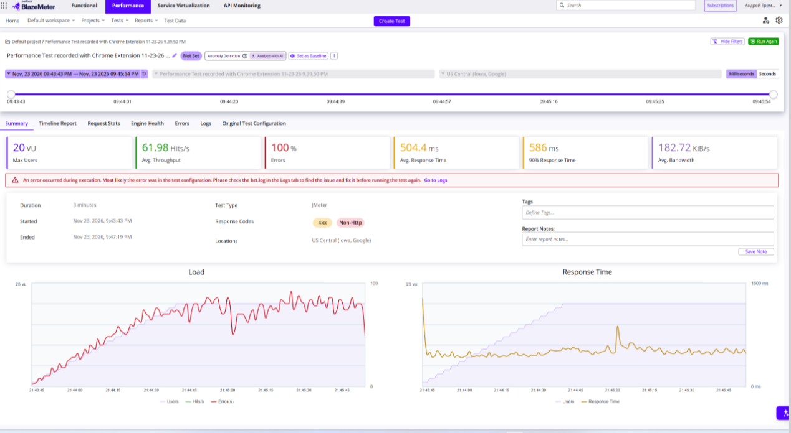
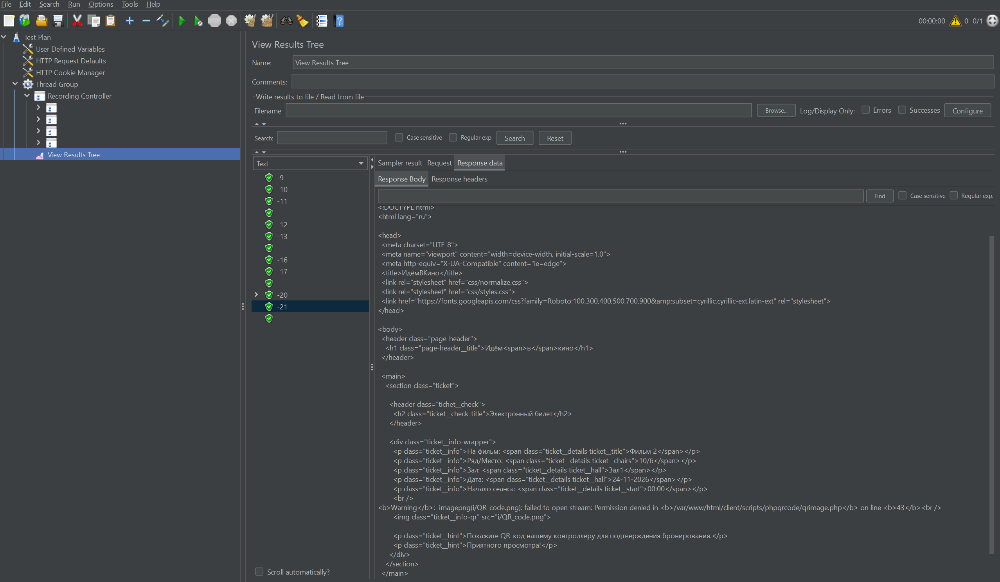
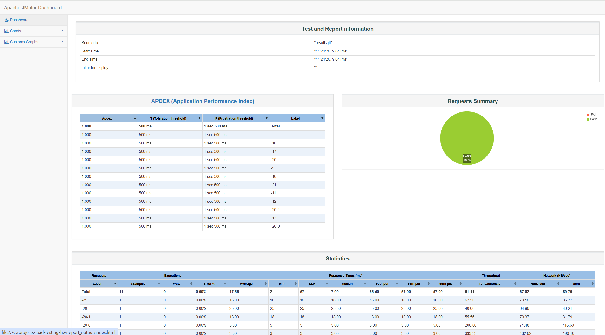

# Домашнее задание к лекции 3: «Проведение нагрузочного тестирования WEB»

## 1. Тестирование добавления комментария в BlazeMeter
* Записан и проигран сценарий добавления комментария в блоге WordPress.
* Скриншот результатов нагрузки: screenshots/1_blazemeter_summary.png

## 2. Нагрузочное тестирование в Apache JMeter (покупка билета и получение QR-кода)
* Развернут локальный стенд кинотеатра (congenial-potato) в Docker.
* В phpMyAdmin обнаружены базы данных: **database**, **information_schema**. Выполнено пересоздание таблиц и импорт актуального дампа БД.
* Разработан и очищен сценарий покупки билета и получения QR-кода (cinema_test.jmx), выполнен прогон для 1 пользователя (100% успешных запросов).
* Скриншот выполнения сценария (View Results Tree): screenshots/2_jmeter_view_results.png
* Скриншот сводного HTML-отчета (
eport_output/index.html): screenshots/3_jmeter_html_report.png

